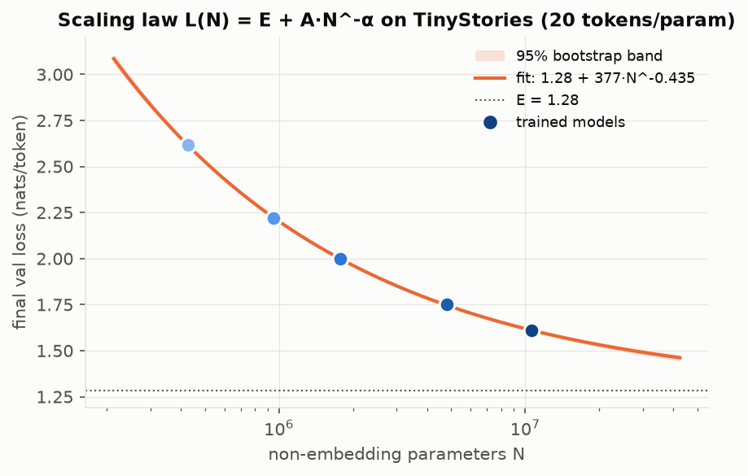
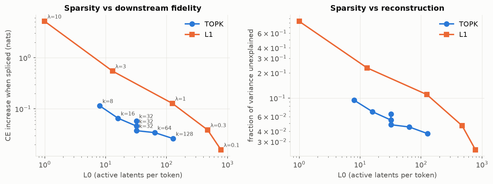
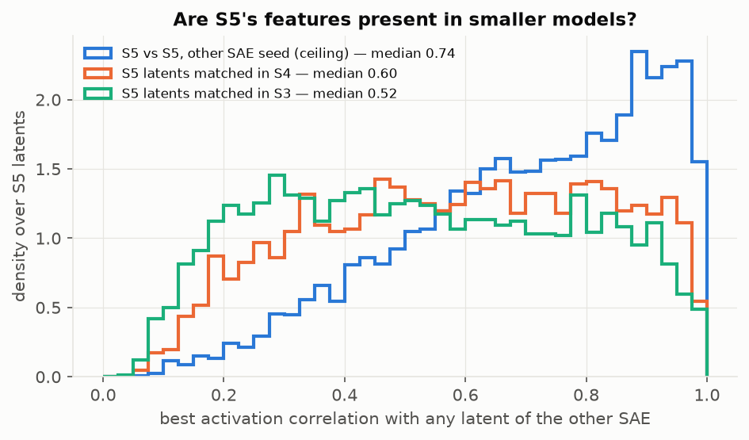

# tinygpt-lab

**A GPT language model, a scaling-law study, and sparse-autoencoder interpretability, all
built from scratch in plain PyTorch.**


tinygpt-lab trains a family of GPT-style models (0.4M to 10.6M parameters) on TinyStories,
fits a scaling law to their losses, and then opens up the largest model with sparse
autoencoders (SAEs) to find the features it uses internally. It closes with an original
question: **do the features of a larger model also exist in smaller ones?**

Every component is implemented by hand: the BPE tokenizer, the transformer, the training loop,
the SAEs and the analysis tools. No HuggingFace `transformers`, nanoGPT, TransformerLens or
`sae_lens`. **Every number below comes from a logged run**, and negative results are reported
alongside the positive ones.

📄 **Paper draft:** [`report/paper.md`](report/paper.md) · 🧭 **Design decisions:**
[`DECISIONS.md`](DECISIONS.md) · 🔍 **Feature dashboard:**
[`report/dashboard/features.html`](report/dashboard/features.html) (download and open it in a
browser)

---

## Key results

### 1. A clean scaling law, which also predicts out of sample

<p align="center"></p>

Five model sizes, each trained at 20 tokens per parameter (Chinchilla-style) with an identical
data order:

| Model | Layers × width | Non-embedding params | Training tokens | Val loss |
|---|---|---|---|---|
| S1 | 2 × 128 | 0.43M | 8.5M | 2.616 |
| S2 | 3 × 160 | 0.95M | 19.1M | 2.221 |
| S3 | 4 × 192 | 1.77M | 35.4M | 1.997 |
| S4 | 6 × 256 | 4.82M | 96.4M | 1.750 |
| S5 | 6 × 384 | 10.6M | 212.4M | **1.608** |

**L(N) = 1.282 + 376.9 · N^(−0.435)**, with α's 95% bootstrap CI at [0.409, 0.461] and an
RMSE of 0.0025 nats.
**Extrapolation test:** fitting only S1–S4 predicts S5 at **1.619**, against **1.608**
measured.

### 2. Sparse autoencoders that keep 99.4% of the model's performance

<p align="center"></p>

The SAEs are trained on S5's residual stream (16× expansion, 6,144 latents). The chosen TopK
SAE (k = 32) explains 94.6% of the variance, has **0% dead latents**, and raises the loss by
only **0.046 nats** when it replaces the real activations. That is **99.4%** of the
zero-ablation gap recovered. **TopK beats L1 at every sparsity level**, matching Gao et al.
(2024).

### 3. Most features are interpretable

In a draft labelling of 50 randomly sampled features, **74% are interpretable**, 16% are
partly interpretable and 10% are not. Examples:

| Feature | Fires on |
|---|---|
| #2411 | the opening quote of a reply that answers a question in dialogue |
| #249 | "anymore" in *"they were not scared anymore"* |
| #4989 | "sun" in *"they played until the sun went down"* |
| #100 | the boundary between two stories |

### 4. Original extension: features across scale

<p align="center"></p>

SAEs trained with the same recipe on S3, S4 and S5 were compared on identical tokens. The
match rate against the largest model's features falls with size: the median best-match
correlation is **0.74** for an S5 SAE with a different seed (the reproducibility ceiling),
**0.60** for S4 and **0.52** for S3. Of the reproducible S5 features, **102 exist only at
the largest scale**, and they differ in kind. They are **contextual rather than lexical**:
their median correlation with a single-token detector is 0.14, against 0.77 for features
shared across all sizes. Examples include *"the noun after 'the other'"* and *"the object of
'ate'"*.

---

## What's implemented

| Component | Details |
|---|---|
| **Tokenizer** | Byte-level BPE (8,192 vocab) with incremental pair-count updates: 7,935 merges over 180 MB in ~7 s, 4.16 bytes/token on held-out text |
| **Model** | Decoder-only transformer: pre-norm RMSNorm, RoPE, SwiGLU, tied embeddings, scaled residual init, manual and SDPA attention (tested to agree), KV-cache generation with temperature, top-k and top-p |
| **Training** | AdamW with decoupled weight decay, warmup + cosine schedule, gradient clipping and accumulation, bf16 autocast, **bit-exact checkpoint resume** (model, optimiser, data position, all RNGs), MFU logging |
| **Scaling** | 7-point LR sweep, Kaplan LR transfer (validated by a 0.5×/1×/2× check), power-law fit with eval-batch bootstrap CIs, L(C) fit, extrapolation test |
| **SAEs** | TopK and L1 variants: unit-norm decoder (gradient projection + renormalisation), pre-encoder bias, input normalisation, AuxK loss for dead latents; evaluated by spliced-in downstream CE |
| **Interpretability** | Top-activating contexts, activation histograms, logit-effect analysis, a static HTML dashboard, ablation and steering tooling, cross-model feature matching |

### Quality bar

- **68 tests**, written before each component. Among them: causality (future tokens never
  change past logits), KV-cache output equal to no-cache output, manual attention equal to SDPA
  to 1e-5, overfitting a single batch, bit-identical resume, SAE decoder-norm and exact-k
  invariants.
- **Full reproducibility:** global seeding, one YAML config per experiment, and the config plus
  git hash saved with every run.
- **Every design choice is justified** in [`DECISIONS.md`](DECISIONS.md) in one line.

---

## Quick start

```bash
git clone https://github.com/kaiffarooqui970/tinygpt-lab.git
cd tinygpt-lab
uv sync                 # creates .venv (Python 3.12) with all dependencies
uv run pytest           # runs the 68 tests
```

### Reproduce the whole pipeline at toy scale (CPU, ~2 min plus download)

```bash
bash scripts/reproduce_tiny.sh
```

This runs every phase on tiny configs (tokenizer → data → LR sweep → scaling sweep →
activations → SAEs → dashboard → interventions → universality → figures) and writes all the
figures to `report_tiny/figures/`. It downloads only the TinyStories validation split.

### Reproduce the full study

```bash
# Phases 1-2: tokenizer and data (466.8M train / 4.7M val tokens)
uv run python scripts/train_tokenizer.py --config configs/tokenizer.yaml
uv run python scripts/prepare_data.py   --config configs/data/tinystories.yaml

# Phases 4-5: LR sweep, five model sizes, LR-transfer check, scaling fit
uv run python scripts/run_sweep.py --config configs/sweeps/lr_sweep_s1.yaml
bash scripts/run_scaling_queue.sh
uv run python scripts/fit_scaling.py --sweep scaling --out report

# Phases 6-9: activations, SAE sweep, universality, dashboard (one script, GPU recommended)
bash scripts/pod_phase6_9.sh

# Figures: regenerates every figure in report/figures from the logged runs
uv run python scripts/make_figures.py
```

### Try the model

```bash
uv run python scripts/sample.py                 # interactive: type a story opening
uv run python scripts/sample.py --model s1      # compare with the smallest model
```

> *Lily wanted a puppy, but her mom said no.* → Lily was sad, but she understood… her mom said
> no because they didn't have enough money to buy them. Lily was sad, but she knew she had to be
> patient…

The model is a **story continuer, not a chatbot**. It was trained only on children's stories,
so give it story openings rather than questions.

---

## Compute

| Stage | Hardware | Time |
|---|---|---|
| Tokenizer, data, tests | Apple M4 laptop (CPU) | < 30 min |
| LR sweep + 5 scaling runs + LR check | Apple M4 (MPS, bf16) | ≈ 9 h (plus ≈ 4 h lost to an abandoned S5 attempt) |
| Activations, 16 SAEs, universality, dashboard | 1× NVIDIA A40 (RunPod) | 1.15 h ≈ **$0.68** |

The whole project ran on one laptop plus about €0.60 of rented GPU time.

---

## Repository layout

```
configs/          YAML configs: tokenizer, data, model sizes, sweeps, SAEs, figures, tiny/
src/tinygpt/
  tokenizer/      byte-level BPE
  data/           tokenisation into uint16 memmap shards, random-window loader
  model/          GPT, layers (RMSNorm, RoPE, SwiGLU, attention), KV-cache generation
  train/          trainer, optimiser groups + LR schedule, metrics (MFU, FLOPs)
  scaling/        sweep runner, power-law fit + bootstrap, analysis
  sae/            activation collection, TopK/L1 SAE, training, evaluation
  interp/         feature statistics, dashboard, interventions, universality
  utils/          seeding, config loading, run directories, JSONL logging, checkpoints
scripts/          thin CLI entry points (one per stage)
tests/            68 pytest tests
report/           paper.md, figures/, results/ (JSON), dashboard/
```

---

## Limitations

These are stated honestly here; the details are in the paper.

- **Small scale:** 0.43M–10.6M parameters (25×). A 25M point was dropped for compute budget.
- **One seed per size:** the confidence intervals capture evaluation noise, not training-seed
  variance.
- **Small SAE datasets:** 2.1M activation tokens per model because of disk limits, against
  the 50–100M typical in the literature.
- **SAE learning rate not tuned:** 1e-3 beats the default 4e-4 (ΔCE 0.037 vs 0.046). The default
  was kept for comparability.
- **Position-0 artifact:** 3 of 50 sampled features fire only on the first token of a context
  window, because that position has no preceding context.

## Status

| Phase | Status |
|---|---|
| 0–7: setup → tokenizer → data → model → training → scaling → activations → SAEs | ✅ Done |
| 8: interpretation | 🟡 Dashboard and feature labels (draft) done; ablation and steering experiments in progress |
| 9: universality across scale | ✅ Done |
| 10: paper | 🟡 Method, results and limitations written; abstract and conclusion pending |

## References

- Vaswani et al. (2017). *Attention Is All You Need.*
- Kaplan et al. (2020). *Scaling Laws for Neural Language Models.*
- Hoffmann et al. (2022). *Training Compute-Optimal Large Language Models.*
- Eldan & Li (2023). *TinyStories: How Small Can Language Models Be and Still Speak Coherent English?*
- Bricken et al. (2023). *Towards Monosemanticity: Decomposing Language Models With Dictionary Learning.*
- Templeton et al. (2024). *Scaling Monosemanticity.*
- Gao et al. (2024). *Scaling and Evaluating Sparse Autoencoders.*
